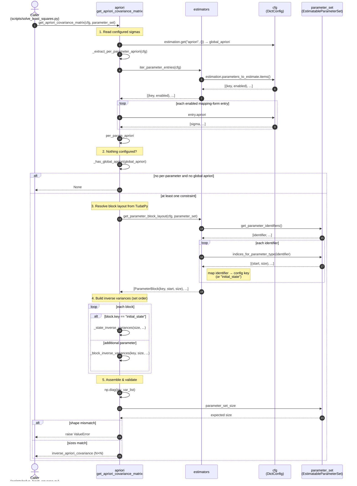
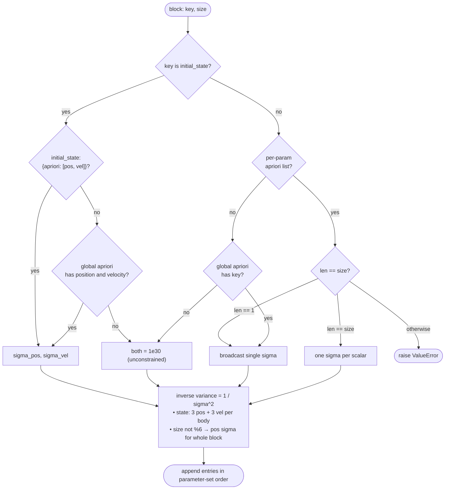

# `apriori.py` interaction diagram

UML **sequence (interaction) diagram** for
[`src/orbitdet/estimation/apriori.py`](../src/orbitdet/estimation/apriori.py),
which builds the diagonal inverse a priori covariance matrix that regularises the
Gauss–Newton normal matrix during estimation.

## High-level flow

## Sigma resolution priority

Within `_block_inverse_variances` / `_state_inverse_variances` each block's sigma
is resolved in priority order:

## Key collaborators

| Participant | Role |
| --- | --- |
| `estimators.iter_parameter_entries` | Normalises plain (`key: true`) and mapping (`key: {value, apriori}`) config forms into `(key, enabled)` pairs. |
| `estimators.get_parameter_block_layout` | Maps each block of the consolidated `parameter_set` to its config key and its real `(start, size)`, in **parameter-vector order** (TudatPy reorders blocks: state → scalars → vectors). |
| `parameter_set` (`EstimatableParameterSet`) | Authoritative source of block identifiers, indices and total size — the reason no per-parameter size table lives in `apriori.py`. |
| `cfg` (`DictConfig`) | Supplies the sigmas from `estimation.apriori` (global) and `estimation.parameters_to_estimate.<key>.apriori` (per-parameter). |

## Notes

- The returned matrix is **diagonal and in parameter-set order**, so its `i`-th
  diagonal entry is the inverse variance of the `i`-th scalar in
  `parameter_set.parameter_vector`.
- If **nothing** is configured anywhere, the function returns `None` (no prior),
  and the caller builds an `EstimationInput` without `inverse_apriori_covariance`.
- The `ParameterBlock` objects themselves are not mutated here; they are only read.
