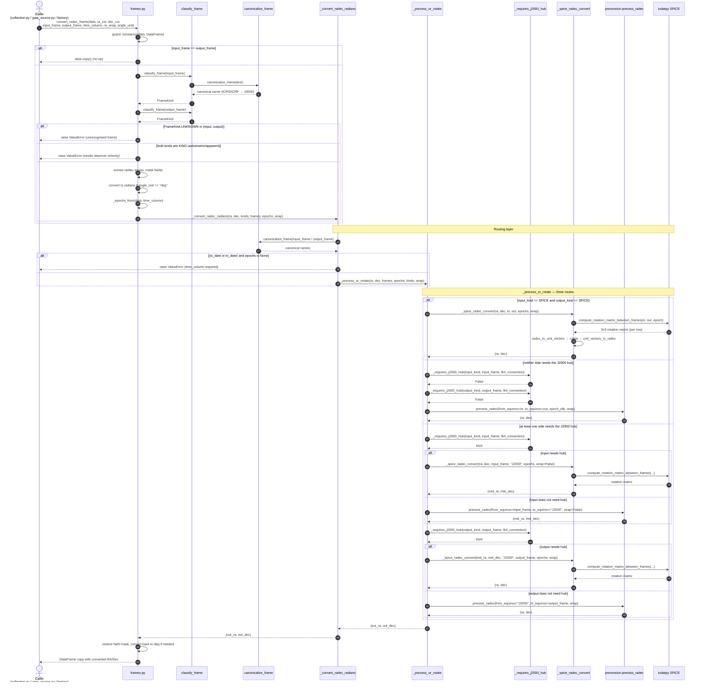
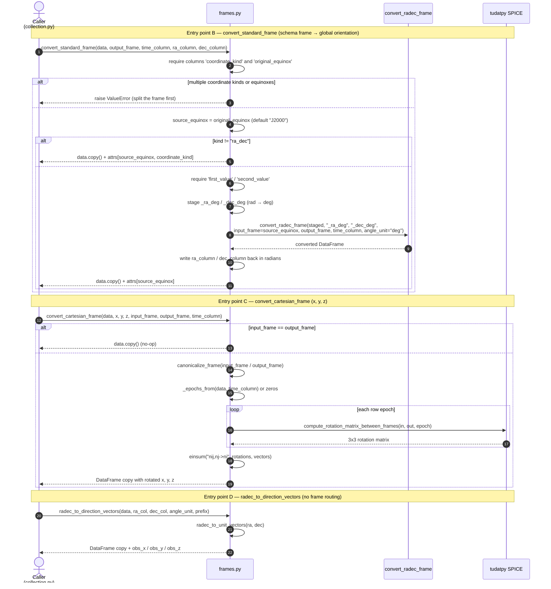

# Frame Resolution & Coordinate Conversion — Interaction Diagram

This document describes the runtime interaction of
`src/orbitdet/preprocessing/frames.py`, the module that owns frame-name
resolution and the routing of coordinate conversions.

The module deliberately contains no coordinate mathematics of its own. It
classifies a frame name, decides which of two leaf implementations should do the
work, and delegates:

- `orbitdet.preprocessing.precession` — the *orientation* of the axes (J2000,
  B1950, mean or true equinox of date, arbitrary Julian/Besselian epochs).
- `orbitdet.preprocessing.aberration` — the *kind* of direction (apparent versus
  astrometric).
- `tudatpy.interface.spice` — the fixed rotations between SPICE frames.

## Participants

| Participant | Role |
| --- | --- |
| `Caller` | `observations/collection.py`, `data/gaia_source.py`, dataset factories |
| `frames.py` | Public API and routing (`convert_radec_frame`, `convert_standard_frame`, `convert_cartesian_frame`, `radec_to_direction_vectors`) |
| `classify_frame` | Maps a name onto a `FrameKind` family |
| `canonicalize_frame` | Rewrites aliases; `ICRS`/`ICRF` → `J2000` |
| `_convert_radec_radians` | Radian-level routing entry point |
| `_precess_or_rotate` | Dispatcher: direct SPICE, direct precession, or J2000 hub |
| `_requires_j2000_hub` | Predicate deciding whether a frame needs the J2000 intermediate |
| `_spice_radec_convert` | Leaf: SPICE rotation, one matrix per row |
| `precession.precess_radec` | Leaf: precession / FK4-FK5 via Astropy or SPICE |
| `tudatpy SPICE` | `compute_rotation_matrix_between_frames` |

## Sequence diagram — `convert_radec_frame`

## Sequence diagram — the other entry points

## Routing rules (at a glance)

| Condition | Route | Implementation |
| --- | --- | --- |
| both frames `FrameKind.SPICE` | direct SPICE rotation | `_spice_radec_convert` |
| neither frame needs the J2000 hub | direct precession | `precession.precess_radec` |
| either frame needs the J2000 hub | chain through `J2000` | both, in sequence |

`_requires_j2000_hub` returns `True` for:

- a SPICE frame with no equinox meaning — `ECLIPJ2000`, `ECLIPB1950`;
- `B1950` under `Fk4Convention.SPICE`, where the FK4 leg must be SPICE's fixed
  rotation rather than Astropy's E-term-correcting FK4;
- a Besselian equinox that is exactly B1950 under `Fk4Convention.SPICE`.

A Besselian equinox other than B1950 (`B1905`, `1899.0`) is **not** hubbed,
because `B1950` is the only Besselian frame CSPICE defines; those epochs go
through Astropy FK4 instead.

## Frame-name vocabulary

| Family | Examples | `FrameKind` | Handled by |
| --- | --- | --- | --- |
| SPICE frames | `J2000`, `B1950`, `ECLIPJ2000`, `ECLIPB1950` | `SPICE` | `_spice_radec_convert` |
| ICRS aliases | `ICRS`, `ICRF` | `SPICE` (after canonicalisation) | `_spice_radec_convert` |
| Equinox labels | `J2015.0`, `1905.0`, `B1905` | `EQUINOX` | `precession.precess_radec` |
| Of-date | `date`, `of date`, `MOD` | `OF_DATE` | `precession.precess_radec` |
| True of date | `true of date`, `TOD` | `TRUE_OF_DATE` | `precession.precess_radec` |
| Kind labels | `astrometric`, `apparent` | `KIND` | `aberration` (not from frame names alone) |
| Unrecognised | `nonsense`, `""` | `UNKNOWN` | raises `ValueError` |

## Notes and caveats

- **`ICRS`/`ICRF` are aliases for `J2000`, not a distinct frame.** The SPICE
  kernels this pipeline loads (`DE440.bsp`, `nep097.bsp`, the IAU rotation
  models) are ICRF-referenced and merely *labelled* `J2000`; NAIF states that no
  transformation is required between the two for such data. Applying the FK5
  frame bias (~17–20 mas) would therefore introduce an error rather than remove
  one. See the "ICRF vs J2000" section of the
  [NAIF frames required reading](https://naif.jpl.nasa.gov/pub/naif/toolkit_docs/C/req/frames.html).
- **Aliases are resolved once, at the top of `_convert_radec_radians`.** This
  keeps the precession vocabulary from having to know about `ICRS`, which would
  otherwise be logged as an unrecognised equinox and silently assumed to be
  J2000.
- **The epoch is only required for of-date frames.** `ICRS`/`J2000` and the
  other fixed frames need no time at all; passing `time_column` for them is
  harmless but ignored.
- **`convert_standard_frame` is the only entry point that calls another public
  function** (`convert_radec_frame`) rather than the private routing layer,
  because it stages the radian `first_value`/`second_value` columns into degrees
  first — `convert_radec_frame` predates the radians convention.
- **Non-`ra_dec` standard frames are passed through untouched.** A
  `cartesian_xy` frame needs the reference body's topocentric direction to
  invert the projection, and a `position_angle_separation` frame's angle is
  defined relative to the frame's north pole; neither can be rotated on its own.
  The equinox is reported back in `attrs["source_equinox"]` for the caller.
- **`convert_cartesian_frame` does not classify frames.** It canonicalises the
  names and hands them straight to SPICE, so a non-SPICE name (e.g. `date`)
  fails inside SPICE rather than being routed.
- **NaN handling.** `convert_radec_frame` masks non-finite rows before the
  conversion and restores them afterwards, so a conversion never fills a NaN.
  `_spice_radec_convert` propagates a non-finite epoch as a NaN rotation matrix.
- **Performance.** The module loops the scalar SPICE calls (`pxform` is
  scalar-only) but vectorises all trigonometry, which is ~12x faster than the
  previous row-wise `DataFrame.apply` for bit-identical output.
