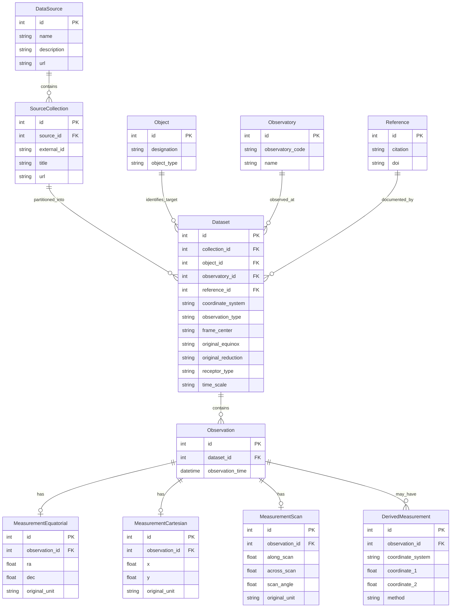

# NeptuneOD

This document specifies what the design of each component _should_ be. The code does not yet reflect this because half of it is vibe coded and the other half is half a year old and has gone through a bunch of half baked refactors. 

## Data model
The data pipeline consists of multiple components
1. Acquisition & Formatting
2. Pre-processing
3. Model generation
4. Estimation
5. Post processing

### Data acquisition
The data module is responsible for downloading data and using preprocessing tools to standardize this data

The standard data structure is a pandas data frame with the columns:
- Observed object
- Observatory code (or name if not avaible)
- Data source (NSDB (with set ID), MAST, Gaia archive)
- Reference (academic reference)
- Type (relative, absolute)
- Coordinates (PS, RA/DEC, XY)
- Center of frame (Topocentric, Geocentric)
- Original Epoch of equinox
- Original Reduction
- Receptor type (CCD, Photographic plate, Visual)
- Observation epoch (TDB, seconds since J2000)
- First observation value (RA, Position angle, X)
- Second observation value (DEC, Separation, Y)

This should maybe be a basic database structure.
A proposal with the following tables:
- dataset: One row per observational dataset.
- observation: One row per observation, linked to its dataset.
- measurement_equatorial: Equatorial-coordinate measurements, such as RA/Dec.
- measurement_cartesian: Cartesian or image-plane measurements, such as X/Y.
- measurement_scan: Along-scan/across-scan measurements, such as those associated with Gaia.
- observatory: Observatory codes and names.
- reference: Bibliographic references.
- data_source: Data-source definitions, such as NSDB, MAST, and Gaia Archive.

### Preprocessing
The preprocessing module is responsible for providing tooling used in the data acquisition module for formatting data into a standard pandas dataframe.
It provides methods for:
- Time format conversion: Multicolumn, Iso-string, JD, MJD into seconds since j2000 epoch
- Timescale conversion: Washington mean time, Greenwich M. T., UTC, UT1, TCB, ET into TDB (tudatpy standard time)
- Epoch of equinox precession: mean of date, true of date, astrometric (B1xxx, J2xxx) to J2000
- Reduction catalogue correction/precession (for catalogue error AND proper motion of the star): UCAC, HCRF, USNO to Gaia-CRF3 (Best tie to ICRF (J2000 in spice)) (note, J2000 and EME2000 are the same, but not in spice. In spice J2000 is ICRF. J2000 and ICRF differ less than 100mas, but the distinction must be made. see https://naif.jpl.nasa.gov/pub/naif/toolkit_docs/Tutorials/pdf/individual_docs/17_frames_and_coordinate_systems.pdf)
- Apparent to astrometric reference frames (Stellar abberation)

Sources for this process:
1. Yuan, Y., Li, F., Fu, Y., & Ren, S. 2021, A&A, 645, A48

### Model generation
This module provides factory methods for converting the PD dataframes into SingleObservationSet objects for use in tudatpy. It takes the dataframe from data acquisition and dispatches to appropriate factory functions. It is responsible for partitioning into SingleObservationSets. Partitioning is performed on coordinate type and observatory as a composite key.

Factories should exist for:
- absolute_ra_dec
- relative_ra_dec
- relative_xy
- voyager_ra_dec
- voyager_pixel_line (might not get implemented)
- gaia_ra_dec
- hubble_xy

### Estimation
This module provides estimation methods

### Post processing
This module provides analysis tools to generate tables, figures, and other data products

It takes the output from the estimation and places them in a standardized pandas dataframe. Currently implemented as dataset_metadata in 'solve_least_squares.py'
It should have columns:
- dataset (Foreign key?)
- observatory_code 
- coordinate type
- Observation collection index: Bookkeeping to keep track of single observation sets and their metadata

Analyses that should be available:
- Reduced Chi-squared
- WRMS/NRMS 

Plots that should be available:
- 
Plots should come with configurations to set figure title, axis title, A4 portion size (full A4, half height, quarter height, quarter size (corner figure), custom)

## Configurations

### Experiments, Scripts & the Results folder
1. Experiments are (for now) hydra configurations. (Maybe these should become snakemake sequences)
2. Scripts are programs/tools that accept hydra configurations.
3. The results folder is separated by EXPERIMENT not by script. If an experiment is named "fit_to_ephemeris" and uses only the script "solve_least_squares.py", it shall save its results in a subfolder named "fit_to_ephemeris" and have a single run saved in a folder named with an iso-string at the time of creation. A sweep shall have its subfolder named with the index of the run. 
4. An experiment that can be swept MUST first define metrics that are stored per run. for example:
- RMS residual of each iteration
- Best RMS residual
- RSW and norm RMS residual of each iteration
- RSW and norm RMS residual of the best iteration
This allows plotting in AIMstack or custom experiment specific plotting tools
5. Experiment specific plotting tools live in the visualization module, and must be generalized such that they can be reused. A simple wrapper script should then call the components of the analysis and ingest data for post-processing

## Weighting
Data weighting is central to the quality of results obtained

Strategies exist and must be specified at the dataset descriptor (yaml file) level.
Large varying should be done using hydra overrides.
If various datasets should be grouped, a groupname can be specified which combines the datapoints as if they were a single set. If there is a strategy mismatch in a group, an exception is raised.

## Outlier rejection
Outlier rejection is specified at the dataset descriptor level.
Several outlier rejection schemes can be active at once. 
IF various datasets should be grouped, a groupname can be specified which combines the datapoints as if they were a single set. This is a different group than used for weighting.
There exists a single group strategy which must match between all members of the group. There also exists a strategy specific to the dataset itself. This does not have to match.
First the dataset level rejection is performed, and then the group level is performed.

