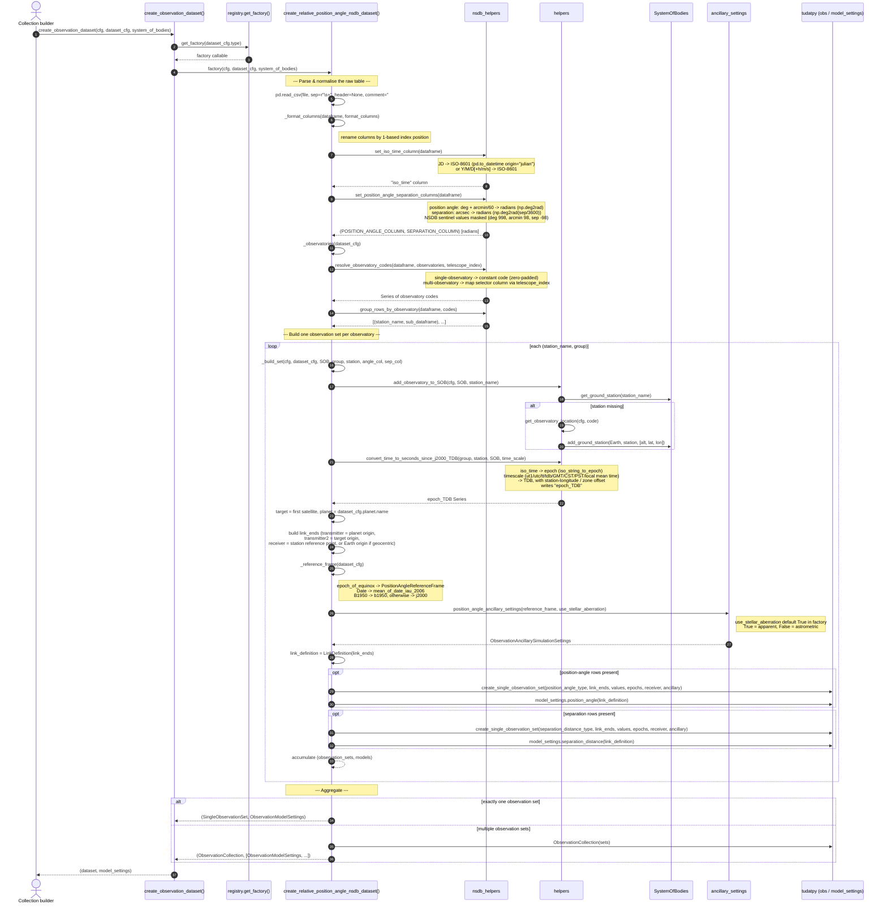

# Relative Position-Angle & Separation Observation Model — Interaction Diagram

This document describes the runtime interaction of the
`relative_position_angle_and_separation_*_nsdb` dataset factory
(`src/orbitdet/observations/relative_position_angle_nsdb.py`), from the point where the
collection builder dispatches on the dataset `type`, through parsing, time/angle
conversion, per-observatory observation-set construction, and finally aggregation into
a Tudat `ObservationCollection` plus observation-model settings.

## Sequence diagram

## Conversion responsibilities (at a glance)

| Concern | Where handled | Notes |
| --- | --- | --- |
| Time **format** (JD / Y-M-D / h-m-s → ISO-8601) | `nsdb_helpers.set_iso_time_column` | via `pd.to_datetime(..., origin="julian")` or component assembly |
| Time **standard / zone** (UT1, UTC, TT, TDB, GMT, CST, PST, local mean time → TDB seconds since J2000) | `helpers.convert_time_to_seconds_since_j2000_TDB` | uses `time_rep.default_time_scale_converter`; zone/local-mean offsets applied |
| Position-angle **units** (deg + arcmin → rad) | `nsdb_helpers.set_position_angle_separation_columns` | `np.deg2rad` |
| Separation **units** (arcsec → rad) | `nsdb_helpers.set_position_angle_separation_columns` | `np.deg2rad(sep / 3600)` |
| **Epoch of equinox** (pole convention) | `relative_position_angle_nsdb._reference_frame` | Date → IAU 2006 mean-of-date; B1950 → b1950; else → j2000 |
| **Apparent vs astrometric** (stellar aberration) | `ancillary.position_angle_ancillary_settings` | factory default `use_stellar_aberration=True` (apparent) |

## Notes and caveats

- **Equinox fallback is silent.** `_reference_frame` only recognises `Date`/`Of Date`
  and `B1950*`; every other value (`J2015.0`, `1899.0`, `no information`, ...) silently
  maps to `j2000` rather than warning or raising.
- **No coordinate rotation here.** Unlike the absolute RA/Dec factories (which call
  `convert_radec_frame` against `cfg.global_frame_orientation`), this factory only uses
  the equinox to choose the **north-pole convention** for the position angle; the
  observations are already angles, so no frame rotation of coordinates is performed.
- **Aberration is not data-driven yet.** `use_stellar_aberration` is not defined in any
  dataset YAML under `conf/datasets/**`, so it always defaults to `True`. The NSDB
  `reduction` field (e.g. "corrected for full relativistic aberration but not for
  relativistic light deflection") is parsed by `src/orbitdet/data/nsdb.py` but is not
  consumed by this factory.
- **Position angle vs separation split.** Rows with a valid angle and rows with a valid
  separation become *separate* `SingleObservationSet`s (and matching model settings);
  when only one component exists, a single set is returned instead of a collection.
